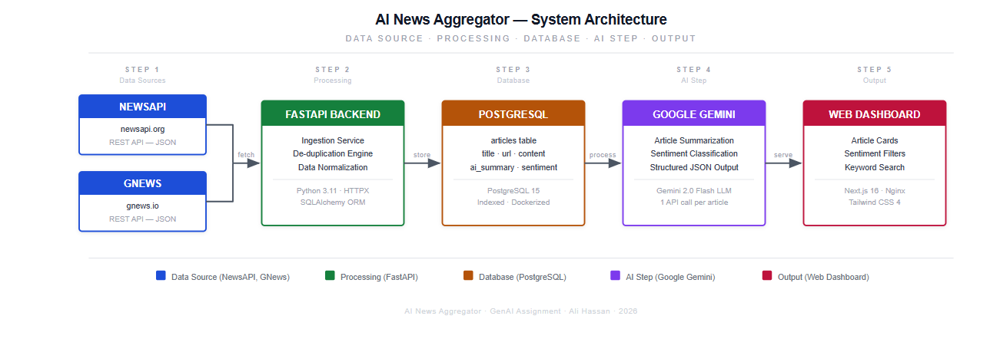

<div align="center">

# AI News Aggregator

**A full-stack news intelligence dashboard that ingests headlines from multiple providers, de-duplicates them, and enriches every article with an AI-generated summary and sentiment label.**


</div>

---

## Overview

AI News Aggregator pulls the latest headlines from **NewsAPI** and **GNews**, stores them in **PostgreSQL** with automatic de-duplication, and runs each article through an LLM to produce a concise 2–3 sentence summary and a **positive / neutral / negative** sentiment label. Results are served through a documented REST API and visualised on a filterable Next.js dashboard. The entire stack starts with a single `docker compose up`.

<p align="center">
  
</p>

## Key Features

- **Multi-source ingestion**: aggregates two independent news providers into one normalised schema
- **Automatic de-duplication**: identical stories across providers are stored only once
- **AI enrichment**: LLM summarisation and sentiment classification via the Anthropic API
- **Graceful degradation**: falls back to a fast local keyword classifier when no API key is set or the API is unavailable
- **Interactive dashboard**: filter by sentiment and source, full-text keyword search, at-a-glance statistics
- **REST API with OpenAPI docs**: interactive Swagger UI at `/docs`
- **One-command deployment**: Docker Compose locally, `render.yaml` blueprint for Render

## Tech Stack

| Layer          | Technology                                   |
| -------------- | -------------------------------------------- |
| Backend        | Python 3.11, FastAPI, SQLAlchemy 2.0         |
| Database       | PostgreSQL 15                                |
| AI             | Anthropic API (Claude 3 Haiku), keyword fallback |
| Frontend       | Next.js 16, React 19, TypeScript, Tailwind CSS 4 |
| Web server     | Nginx (static hosting and `/api` reverse proxy) |
| Infrastructure | Docker, Docker Compose, Render               |
| Data sources   | NewsAPI, GNews                               |

## Getting Started

### Prerequisites

- [Docker](https://docs.docker.com/get-docker/) and Docker Compose
- API keys for [NewsAPI](https://newsapi.org) and [GNews](https://gnews.io) (free tiers available)
- *(Optional)* An [Anthropic API key](https://console.anthropic.com) for LLM summaries

### Installation

```bash
git clone https://github.com/alihassan-9/ai-news-aggregator.git
cd ai-news-aggregator
cp .env.example .env        # then add your API keys
docker compose up --build
```

On first start the backend fetches articles and enriches them automatically.

| Service        | URL                          |
| -------------- | ---------------------------- |
| Dashboard      | http://localhost:8080        |
| API (Swagger)  | http://localhost:8000/docs   |

### Environment Variables

| Variable            | Required | Description                                             |
| ------------------- | :------: | ------------------------------------------------------- |
| `NEWSAPI_KEY`       | Yes      | NewsAPI key                                             |
| `GNEWS_KEY`         | Yes      | GNews key                                               |
| `ANTHROPIC_API_KEY` | No       | Enables LLM summaries; keyword sentiment is used without it |
| `POSTGRES_*`, `DATABASE_URL` | Yes | Database settings (defaults work with Docker Compose) |

## API Reference

| Method | Endpoint                    | Description                                   |
| ------ | --------------------------- | --------------------------------------------- |
| `GET`  | `/api/articles`             | List articles (filters below)                 |
| `GET`  | `/api/articles/{id}`        | Retrieve a single article                     |
| `GET`  | `/api/stats`                | Article counts and sentiment breakdown        |
| `POST` | `/api/ingest`               | Trigger a fresh fetch and AI enrichment run   |
| `POST` | `/api/reprocess-sentiment`  | Re-run sentiment classification               |

**Query parameters for `/api/articles`:** `sentiment` (`positive` · `neutral` · `negative`), `source` (`newsapi` · `gnews`), `search`, `limit`, `offset`.

## Project Structure

```
ai-news-aggregator/
├── backend/                  # FastAPI service
│   ├── app/
│   │   ├── core/             # configuration & database session
│   │   ├── models/           # SQLAlchemy models
│   │   ├── routers/          # REST endpoints
│   │   ├── services/         # ingestion, news providers, AI enrichment
│   │   └── main.py           # application entry point
│   ├── Dockerfile
│   └── requirements.txt
├── frontend/                 # Next.js dashboard (served by Nginx)
│   ├── src/
│   │   ├── app/              # pages & global styles
│   │   ├── lib/              # API client
│   │   └── types/            # shared TypeScript types
│   ├── Dockerfile
│   └── nginx.conf
├── db/
│   └── init.sql              # schema & indexes
├── docs/
│   ├── architecture.md       # system & data-flow diagrams (Mermaid)
│   ├── project-report.docx
│   └── assets/               # architecture diagram, demo video
├── docker-compose.yml
├── render.yaml               # Render deployment blueprint
└── .env.example
```

## Architecture

See [`docs/architecture.md`](docs/architecture.md) for the full system overview, request sequence diagram, and technology map. A short demo recording is available at [`docs/assets/demo.mp4`](docs/assets/demo.mp4).

## Deployment

The repository includes a [`render.yaml`](render.yaml) blueprint that provisions the database, backend, and frontend on [Render](https://render.com). After the first deploy, set `NEWSAPI_KEY`, `GNEWS_KEY`, and `ANTHROPIC_API_KEY` in the Render dashboard.

> Free-tier services sleep after 15 minutes of inactivity, so the first request after idle can take ~30 seconds.

## License

Distributed under the MIT License. See [`LICENSE`](LICENSE) for details.

## Author

**Ali Hassan** · [LinkedIn](https://www.linkedin.com/in/ali-hassan-70bb9323b) · [GitHub](https://github.com/alihassan-9)
